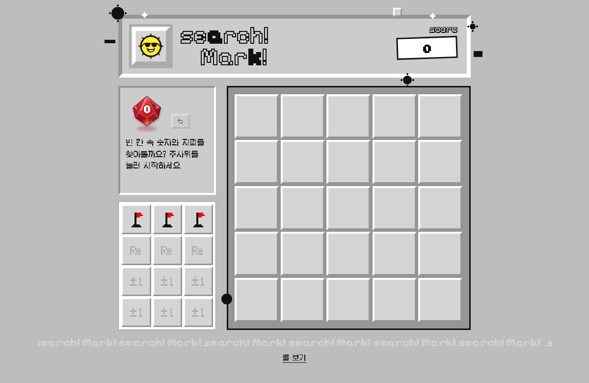

# Search! Mark! (서치마크)

10면체 주사위를 굴려 5×5 칸에 숫자를 적고, 숫자 둘레에 숨은 지뢰를 깃발로 찾아내는 1인 퍼즐 게임이에요.
종이와 펜으로 하는 보드게임 「서치마크」를 웹에서 바로 할 수 있게 옮겼어요.

**▶ 바로 하기: https://dangnuie-web.github.io/search-mark/**

## 규칙 한눈에

- 주사위를 굴려 나온 숫자를 원하는 빈 칸에 적어요. 숫자 둘레 8칸에는 그 숫자만큼 지뢰가 있어요.
- **9**가 나오면 숫자 대신 깃발 1개, **0**이 나오면 1~8 중 원하는 숫자로 적어요.
- 둘레가 다 차면 채점해요. 깃발 수가 숫자와 같으면 동그라미 + 아이템(Re·±1), 다르면 빗금.
- 판이 다 차면 끝. **점수 = 동그라미 숫자 개수 + 동그라미 숫자 중 가장 큰 수**.

자세한 규칙은 게임 아래 **룰 보기**에서 움직이는 예시로 볼 수 있어요.

## 조작

- 주사위를 누르거나 Space: 굴리기
- 왼쪽 아이템 칸을 눌러 사용 (파란 테두리 = 지금 쓸 수 있음)
- ⌘Z / Ctrl+Z: 되돌리기 (주사위 굴림은 되돌릴 수 없어요)
- 위쪽 해 로고: 새 게임

## 만든 방식

설치나 빌드 없이 HTML·CSS·자바스크립트 파일 세 개로 돌아가요. `index.html`을 브라우저로 열면 바로 실행돼요.

## 라이선스

- 코드: MIT
- 게임(규칙·룰북·보드 디자인)·로고·그림: © 2026 Dangnee, all rights reserved
- 폰트: Pixelify Sans, Silkscreen, DotGothic16(Google Fonts), Galmuri(jsDelivr) — 모두 SIL OFL 1.1, 저장소에는 넣지 않고 링크로 불러와요

자세한 내용은 [LICENSE](LICENSE)를 봐 주세요.

만든 사람: Dangnee(당니) · [github.com/dangnuie-web](https://github.com/dangnuie-web) · dangnuie@gmail.com
